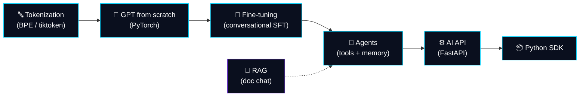
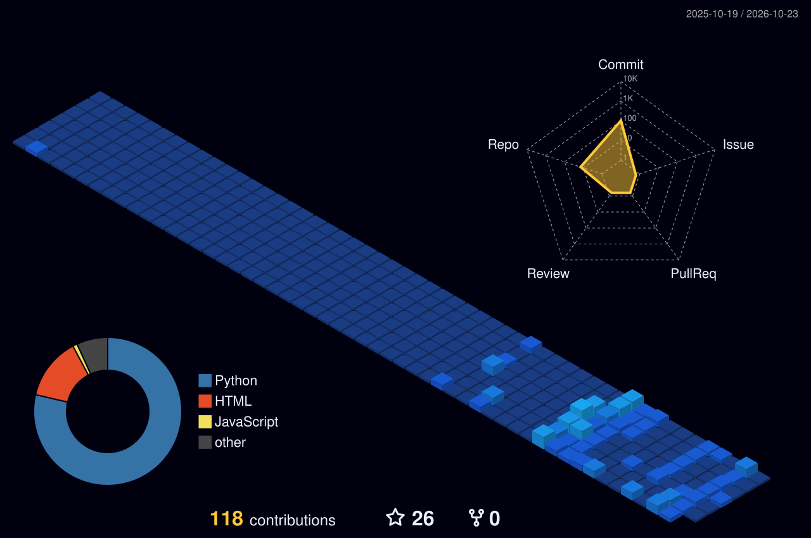

<!-- ═══════════════════════════════════════════════════════════════
     Ashwin Naik — GitHub Profile README
     Save this as README.md in a repo named exactly: ashwin-naik18
     ═══════════════════════════════════════════════════════════════ -->

<div align="center">


<a href="https://github.com/ashwin-naik18">
  
</a>

<br/>

[](https://www.linkedin.com/in/ashwin-naik-30b73b395)
[](https://leetcode.com/u/Ashwin_Naik/)
[](https://github.com/ashwin-naik18)

</div>

---

## `> whoami`

Hey, I'm **Ashwin** 👋, a student who likes knowing how things work *under the hood*.

Instead of only calling an AI API, I try to build the pieces myself: the **tokenizer → transformer → training loop → fine-tuning → agent → API → SDK**. Some of it is rough, all of it is real, and every project teaches me something new.

```python
class Ashwin:
    role     = "Student & AI systems builder"
    focus    = ["LLMs from scratch", "AI agents", "FastAPI backends", "RAG"]
    languages = ["Python", "C", "C++", "JavaScript"]
    toolbox   = ["PyTorch", "LangChain", "NumPy", "Pandas", "Matplotlib"]
    web       = ["HTML", "CSS", "JS", "Flask", "FastAPI"]
    learning = ["Transformers", "Evaluation", "Retrieval", "DSA patterns"]
    approach = "Learn it. Build it. Break it. Fix it. Document it."
```

---

## 🧠 The Stack I'm Building, Layer by Layer



---

## 🚀 Featured Projects

### 🧬 Model Development

| Project | What it is | Tech |
|---|---|---|
| **[AshGPT](https://github.com/ashwin-naik18/AshGPT-llm)** ⭐ | A GPT-style, decoder-only language model implemented in PyTorch. Multi-head self-attention, feed-forward blocks, residual connections, layer norm, dropout, GPT-style init, BPE tokenization (`o200k_base`), token-based chunking, background data prefetching, mixed-precision training on CUDA, and temperature / top-k sampling. Trained on SimpleStories. |   |
| **[AshGPT Fine-tuning](https://github.com/ashwin-naik18/AshGPT-Finetuning-llm)** | Supervised fine-tuning that adapts my custom GPT model toward conversational behavior: data preprocessing, tokenization, sequence packing, and loss masking. |   |

<details>
<summary><b>🧪 Earlier iterations & experiments</b></summary>
<br/>

The path to AshGPT went through a few versions. These repos show how I got there:

- [`gpt-from-scratch-v1`](https://github.com/ashwin-naik18/gpt-from-scratch-v1): my first GPT-from-scratch attempt
- [`mini-gpt-v2-chunked-training`](https://github.com/ashwin-naik18/mini-gpt-v2-chunked-training): second iteration, with chunked training
- [`mini-gpt-v3-chunked-training`](https://github.com/ashwin-naik18/mini-gpt-v3-chunked-training): third iteration, with chunked training

</details>

> ⚠️ *These are educational, from-scratch models. They're built to understand how LLMs work, not to compete with production models.*

### 🤖 Agents & Applications

| Project | What it is | Tech |
|---|---|---|
| **[AshCode](https://github.com/ashwin-naik18/Ash_Code)** | An autonomous AI coding agent built from scratch: tool calling, memory, terminal execution, and autonomous code editing. |   |
| **[WhatsApp Automation Bot](https://github.com/ashwin-naik18/whatsapp-automation-bot)** | An AI-powered WhatsApp assistant with intelligent conversations, browser automation, long-term memory, and tool calling. |    |
| **[Doc Chat RAG](https://github.com/ashwin-naik18/doc-chat-rag)** 🚧 | Work in progress: chat with your documents using retrieval-augmented generation (ingestion → chunking → embeddings → retrieval → grounded answers). |  |
| **[Jarvis Cortex](https://github.com/ashwin-naik18/Jarvis_Cortex)** | An experimental AI assistant project. See the repo for details. |  |

### ⚙️ Backend & Developer Tooling

| Project | What it is | Tech |
|---|---|---|
| **[AshAI Server](https://github.com/ashwin-naik18/ashai-server)** | A production-inspired AI API platform: secure authentication, API-key management, rate limiting, usage logging, and model selection. |   |
| **[AshAI SDK](https://github.com/ashwin-naik18/ashai-sdk)** | The Python SDK for the AshAI API, a simple developer-friendly client instead of hand-written HTTP requests. |  |
| **[Collab Hub](https://github.com/ashwin-naik18/Collab_Hub)** | A Flask collaboration platform where people share project ideas, find collaborators, and apply to join projects. Registration, login, email OTP verification, MySQL. |    |

---

## 🛠️ Tech Stack

**Languages**


**Machine Learning, Deep Learning & Data**


**Backend & Web**


**Tools**


> I know the web basics (HTML, CSS, JS), and my real depth is in Python, ML/DL, and backend work.

---

## 🎯 Currently Focused On

- 🔭 Finishing **Doc Chat RAG**: retrieval quality, source citations, and evaluation
- 🧪 Learning how to **evaluate** models and agents instead of just eyeballing outputs
- 🧹 Polishing my best repos with clearer READMEs, setup steps, and demos
- 🧩 Working through a **structured DSA roadmap**: Arrays & Hashing → Two Pointers → Sliding Window → Stack → Binary Search → Linked Lists → Greedy → DP → Trees → Backtracking → Heaps → Graphs

**Curious about (not built yet):** text-to-image models · blockchain internals · computer vision

---

## 📊 GitHub Stats

<div align="center">


</div>

---

## 📈 Activity

<div align="center">




</div>

---

## 🧩 LeetCode

<div align="center">

<a href="https://leetcode.com/u/Ashwin_Naik/">
  
</a>

*Practicing for patterns and understanding, not just problem counts.*

</div>

---

## 🤝 Let's Connect

I'm always happy to talk about LLMs, agents, backend design, or learning in public. Feel free to open an issue on any repo with feedback. I take it seriously.

<div align="center">

[](https://www.linkedin.com/in/ashwin-naik-30b73b395)
[](https://leetcode.com/u/Ashwin_Naik/)

<br/>

*"Building AI systems from the inside out."*


</div>
